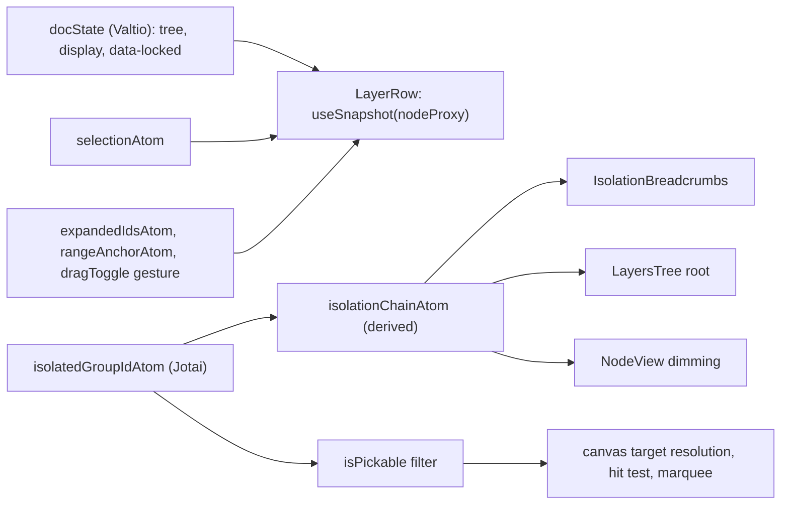

# Layers panel and isolation mode

## Decisions (confirmed)
- Isolation mode **replaces** the existing group editing (`editingGroupIdAtom`). Double-clicking a group isolates it. Double-clicking a plain element still switches to Points (Direct selection), and you stay inside the current isolation.
- Hidden is stored as `display="none"` and locked as `data-locked="true"`. Both are written to the SVG, show up in the code panel, and are recorded by `commitHistory()`, so they can be undone.
- The Layers panel slides out from the **right** edge, can be resized, and is persisted in `appSettings`.

## State architecture

- The primitive `editingGroupIdAtom` in [src/store/4-editor/2-selection-atoms.ts](src/store/4-editor/2-selection-atoms.ts) is renamed to `isolatedGroupIdAtom` and stays in that file to avoid an import cycle with `4-editor`. `exitGroupEditingAtom` is removed. All other isolation logic goes into the new folder.
- Each row subscribes only to its own node through `useSnapshot(nodeProxy)`, the same pattern as `NodeView`, so editing one element re-renders only its row.
- The UI has no `useEffect`. Panel gestures (drag-toggle selection, panel resize) use write-only atoms plus pointer capture on the tree container. Flattened visible order (for Shift ranges) is computed on demand inside the set atom from `docState` and `expandedIdsAtom`.

## New files

### `src/store/6-layers/` (logic, no React)
- `1-layer-attrs.ts`: `isHidden(node)`, `isLocked(node)`, `effectiveState(doc, id)` (whether a hidden or locked ancestor applies), `setNodesHidden(ids, on)`, `setNodesLocked(ids, on)`, `showAll()`, `unlockAll()`. Each commits history.
- `2-isolation-atoms.ts`: `isolationChainAtom` (derived from `groupPathIds` plus the isolated id, outermost first), `enterIsolationAtom(id)`, `exitIsolationLevelAtom` (back to the parent group or to the top level), `exitIsolationToAtom(id | null)` for breadcrumbs, and `isolationRootChildren()` (the children of the isolated group, or `doc.children`).
- `3-pickable.ts`: `isPickable(doc, id, isolatedId)`. A node is pickable when it and its ancestors are neither hidden nor locked, and it is inside the isolated group. Also `filterTarget(target)` for `CanvasTarget`.
- `4-insert.ts`: `insertNodeAtTop(node)`. It pushes into the isolated group, or the root when nothing is isolated, and converts document coordinates to the group's local space with `docToParentMatrix` and `transformNode`. `removeNode(id)` uses `findNode` instead of `doc.children`.
- `5-layer-actions.ts`: actions for the panel's bottom bar.
  - New empty group, placed above the topmost selected item in its parent, or at the top of the isolation root.
  - Group the selection.
  - Isolate the selected group.
  - Duplicate.
  - Delete.
  - Locate: expand the ancestors of the selection and scroll to its row.
- `index.ts`

### `src/components/1-workspace/6-layers-panel/` (UI)
- `0-layers-panel.tsx`: `motion.aside` that mirrors [src/components/1-workspace/5-svg-code-panel/0-svg-code-panel.tsx](src/components/1-workspace/5-svg-code-panel/0-svg-code-panel.tsx). It has a header (title and close button), a scrollable tree, and the bottom bar. The resize handle is on the left edge.
- `1-layers-tree.tsx`: in isolation mode, a header row reads "Isolation Mode" and the isolated group is the tree root, as in your screenshot. Children are listed topmost first, like Adobe (reverse document order). The container handles `onPointerMove` and `onPointerUp` for the drag-toggle gesture.
- `2-layer-row.tsx`: each row contains, in order:
  - an eye button and a padlock button (dimmed when the state comes from an ancestor);
  - an indent and a chevron (groups only, to collapse and expand);
  - a thumbnail and a name (`attrs.id`, otherwise `<Path>`, `<Group>`, `<Rect>`, `<tag>`);
  - the selection circle.

  The row carries `data-layer-id`. Double-clicking a group row isolates it.
- `3-layer-thumbnail.tsx`: a small `<svg>` with the `viewBox` set to the node's document bbox (`nodeDocBBox`). It renders the existing `NodeView` inside a `<g>` that carries the parents' matrix. A CSS override makes hidden nodes still show in the thumbnail.
- `4-layers-bottom-bar.tsx`: icon buttons (lucide icons) for New group, Group, Isolate, Locate, Duplicate and Delete. Their enabled state comes from derived atoms.
- `9-atoms-layers-panel.ts`:
  - `expandedIdsAtom` (a Set) and `toggleExpandedAtom`.
  - `rangeAnchorAtom`.
  - `circleClickAtom({ id, shift, ctrl })`:
    - a plain click selects only that item;
    - Ctrl+click toggles one item;
    - Shift+click selects the range from the anchor (the last plain click, or the first selected item) to the clicked item, in visible order.
  - `dragToggleDownAtom`, `dragToggleMoveAtom` and `dragToggleUpAtom`. Dragging toggles each row crossed once, relative to the selection before the drag. Releasing without moving counts as a plain click.
  - Panel resize atoms.
- `index.ts`

### `src/components/1-workspace/7-isolation-breadcrumbs/`
- `0-island-isolation-breadcrumbs.tsx`: a floating island under the main toolbar, animated in and out with `motion`. It shows a back arrow (up one level), a root item (the file name, which exits isolation completely), then each group in the chain (click to jump to that level). The last item is bold. It reads only `isolationChainAtom`.

## Changes to existing files
- [src/store/1-ui-settings.ts](src/store/1-ui-settings.ts): add `layersPanel: { open, width }` to `AppSettings`, the defaults, and `loadSettings`.
- [src/components/1-workspace/0-all/0-all-workspace.tsx](src/components/1-workspace/0-all/0-all-workspace.tsx): mount `<LayersPanel />` after the canvas container, and add `<Island_IsolationBreadcrumbs />` to the top column of `FloatingUi`.
- [src/components/1-workspace/1-canvas/9-atoms-canvas-root.ts](src/components/1-workspace/1-canvas/9-atoms-canvas-root.ts): `toToolEvent` passes `target` through `filterTarget`, so locked, hidden and out-of-isolation nodes count as empty canvas for every tool. Hover uses `isolatedGroupIdAtom`.
- [src/tools/0-shared/2-tool-helpers.ts](src/tools/0-shared/2-tool-helpers.ts): `hitTestOutlines` skips nodes that are not pickable and does not descend into hidden subtrees.
- [src/tools/tool-2-select/1-select.ts](src/tools/tool-2-select/1-select.ts):
  - Double-click on a node: if its unit under the isolation root (`selectionUnitId`) is a group, isolate it and select the next-level unit under the pointer. Otherwise switch to Points, as now.
  - Double-click on empty canvas: exit one isolation level.
  - Ctrl+click deep-selects the leaf without changing isolation.
  - The marquee and lasso collect bboxes from `isolationRootChildren()` and filter them with `isPickable`. `elementPolylines` looks the node up with `findNode` instead of `doc.children`.
  - Update the hint text.
- [src/tools/tool-4-shapes/1-shape-tool-factory.ts](src/tools/tool-4-shapes/1-shape-tool-factory.ts), [src/tools/tool-5-pen/index.ts](src/tools/tool-5-pen/index.ts) and `insertSvgMarkup` in [src/store/3-document/4-doc-actions.ts](src/store/3-document/4-doc-actions.ts): use `insertNodeAtTop` and `removeNode`, so new shapes and pasted content go into the isolated group.
- [src/components/1-workspace/1-canvas/2-doc-layer/2-node-view.tsx](src/components/1-workspace/1-canvas/2-doc-layer/2-node-view.tsx): add an optional `inside` prop. While isolated, nodes that are neither on the chain nor inside it get `data-isolation-dim`, which a CSS rule renders as `opacity: .3; pointer-events: none`.
- [src/components/1-workspace/1-canvas/3-overlay/2-selection-overlay.tsx](src/components/1-workspace/1-canvas/3-overlay/2-selection-overlay.tsx): remove the dashed rectangle drawn around the group being edited (the dimming replaces it).
- [src/store/4-editor/1-tool-atoms.ts](src/store/4-editor/1-tool-atoms.ts): stop clearing the group on tool switch, so isolation survives Points, shape and pen tools.
- [src/store/4-editor/5-history-atoms.ts](src/store/4-editor/5-history-atoms.ts): `pruneSelectionAtom` drops an isolated id that no longer exists. It also removes locked or hidden ids from the selection.
- [src/store/5-controllers/2-keyboard.ts](src/store/5-controllers/2-keyboard.ts): Escape switches back to the Selection tool if another tool is active. With Selection already active, it exits one isolation level, and with no isolation it deselects.
- [src/components/1-workspace/1-canvas/4-context-menu/9-atoms-context-menu.ts](src/components/1-workspace/1-canvas/4-context-menu/9-atoms-context-menu.ts): use the renamed atom and the pickable filter.
- [src/commands/0-all-commands.ts](src/commands/0-all-commands.ts):
  - New commands: `view.layersPanel` (Ctrl+Shift+L), `object.isolate`, `object.exitIsolation`, `object.hide` (Ctrl+Shift+H), `object.lock` (Ctrl+Shift+K), `object.showAll` and `object.unlockAll`. I avoided Illustrator's Ctrl+2, Ctrl+3 and F7 because browsers reserve them.
  - `edit.selectAll` selects only the pickable children of the isolation root.
  - Delete and Hide also clear the selection.

## Out of scope (can follow later)
- Reordering layers by drag-and-drop in the tree.
- Renaming layers in place.
- Dragging across the eye and lock icons to toggle several rows at once.
