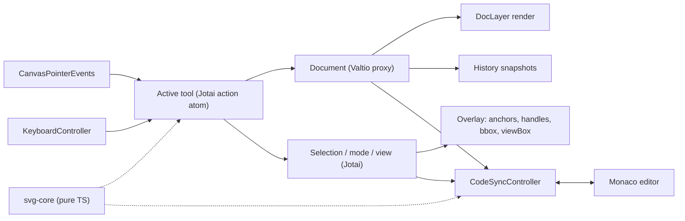

# SVG LED editor - architecture and implementation plan

## Key decisions
- **Scope:** everything in the request. That covers select and point modes, drawing tools including the pen, the viewBox and fit dialog, Monaco sync, undo and redo, and persistence.
- **Native shapes:** `rect`, `circle`, `ellipse`, `line`, `polyline` and `polygon` are edited with parametric handles. A "Convert to path" command opens them up for full anchor editing.
- **Template:** remove the header, footer, demos and login dialog. Keep the Welcome page (optional), the confirmation dialog, toaster, theme and shadcn UI.
- **State:** Valtio holds the SVG document. Each element is its own proxy, so dragging a point re-renders only that element. Jotai holds tools, mode, selection, viewport and UI, and exposes write-only "action atoms".
- **No `useEffect` / `useCallback` in components:** that logic moves into Jotai atoms (see "Component rules" below). App-wide integration (keyboard, code sync, autosave) lives in module-level controllers that use one Jotai store (`createStore` + `Provider`) together with `store.sub` and Valtio `subscribe`. They are installed once from [src/main.tsx](src/main.tsx).

## Component rules
- Components do not use `useEffect` or `useCallback`. They read state with `useAtomValue` / `useSnapshot` and get handlers from `useSetAtom(someActionAtom)`. The setter is already stable, so no `useCallback` is needed.
- Logic that used to live in hooks goes into atoms:
  - Event handlers and multi-step updates become write-only action atoms: `atom(null, (get, set, arg) => ...)`.
  - Computed values become derived read atoms.
  - Subscriptions such as window listeners, `ResizeObserver`, or Valtio `subscribe` use `atom.onMount`, which runs while the atom has subscribers and returns its own cleanup.
  - Per-instance state, for example for each element or anchor, uses `atomFamily` from `jotai-family`, keyed by node id.
  - DOM and imperative APIs (canvas `<svg>`, Monaco `onMount`) are passed to a setter atom through a ref callback or the library's mount callback, not an effect.
- **Atom placement:**
  - Atoms used only by one component go in a separate file next to it, named `9-atoms-<component>.ts`. This follows the template's existing `9-types-*.ts` files that sit next to dialogs.
  - Atoms shared by several components or controllers go in `src/store/4-editor/` (or the matching store folder).
  - When a local atom gains a second consumer, it moves to `store/`.

Example layout:

```
components/1-workspace/2-toolbar/
  1-toolbar.tsx
  2-tool-button.tsx
  9-atoms-toolbar.ts        hover tooltip, overflow-menu open state, local action atoms
components/1-workspace/4-code-panel/
  1-code-panel.tsx
  2-monaco-host.tsx
  9-atoms-monaco-host.ts    editorInstanceAtom, setEditorAtom (from onMount), decorations sync via onMount
```

## Data flow



## Folder structure (new code isolated by feature)

```
src/
  svg-core/                 pure TS, no React, vitest-covered
    1-model/                types: SvgDoc, SvgNode union (path, rect, circle, ellipse, line,
                            polyline, polygon, g, passthrough), Anchor, SubPath, ViewBox
    2-parse/                parse-svg (DOMParser), parse-path-data, parse-transform
    3-serialize/            serialize-svg (+ element-id -> line-range map), serialize-path (precision)
    4-geometry/             matrix, bezier (split, nearest-t, bbox), bbox, hit-test
    5-anchors/              path<->anchors conversion, anchor-ops (add/delete/convert/move-handle)
    6-shapes/               per-primitive handle definitions, shape-to-path
    7-ops/                  fit-to-viewbox, transform-elements (bake or prepend matrix)
  store/
    1-ui-settings.ts        (existing, re-keyed; app-level prefs)
    2-persist/              storage-keys.ts, atomWithToolOptions (per-tool keys)
    3-document/             doc-store (Valtio), doc-history, doc-actions
    4-editor/               tool, mode, selection, hover, viewport atoms + action atoms
    5-controllers/          keyboard, code-sync, autosave, clipboard/file-drop
  tools/
    1-types.ts              ToolDef interface
    2-registry.ts           ordered list -> drives toolbar, shortcuts, command palette
    3-modifiers.ts          one table mapping Ctrl/Shift/Alt to behaviors per tool
    hand/ select/ points/ rectangle/ ellipse/ line/ pen/
  components/
    0-all/                  app, globals (dialogs)
    1-workspace/
      1-canvas/             canvas-root, doc-layer, overlay-layer, marquee, viewbox-frame
      2-toolbar/            toolbar, tool-button, lock toggle, main-menu (screenshot 3)
      3-properties-popup/   property-section registry by node kind
      4-code-panel/         slide-out panel, monaco-host, sync checkbox
      5-corner-controls/    zoom -/%/+, undo/redo, help
    4-dialogs/              confirmation (kept), fit-to-viewbox, viewbox-settings, shortcuts-help
    5-welcome/              kept, optional
                            (each component folder may hold 9-atoms-<component>.ts for local atoms)
```

To add a feature later, add a tool folder plus a registry entry, a property section, or a controller. Existing files stay untouched.

## Core model (`svg-core`)
- Every node gets an internal `id` that is never written to the output. Attributes the editor does not understand are preserved, so files round-trip cleanly. Unknown elements (`text`, `defs`, gradients, `use`, and so on) become `passthrough` nodes. They render as raw markup and can be selected and moved through `transform`.
- A path keeps its original `d` string until its points are edited. After that, `d` is regenerated from anchors as absolute commands, at the precision set in preferences.
- **Anchor model, Illustrator to SVG mapping:**
  - Each anchor is `{ id, x, y, in?, out?, kind: 'corner' | 'smooth' | 'cusp' }`, and each subpath is `{ anchors, closed }`.
  - A segment becomes `L` when both facing handles are absent, and `C` otherwise (a missing handle equals the anchor itself).
  - `Q`, `S`, `T` and `A` are converted to `C` on first edit.
  - `kind` is inferred on import: `smooth` when the handles are collinear, `cusp` when they are independent, `corner` when there are no handles.
- Transforms are parsed into matrices, so the overlay can map world coordinates to screen coordinates through nested `g` transforms without touching the DOM.

## Canvas
- Full-screen `<svg>`.
- The document layer renders the model as React SVG elements, one `useSnapshot` per element, inside a `g` with the viewport transform (pan and zoom).
- The overlay layer draws in screen space, so handles keep a constant size. It shows the viewBox frame with a dimmed outside, the selection bbox, anchors (square, filled when selected), and handle lines with round knobs, as in Illustrator.
- Pointer input:
  - One `onPointerDown` / `Move` / `Up` dispatches to the active tool's action atom, using pointer capture.
  - Wheel zooms around the cursor.
  - Space, the middle mouse button, or the hand tool pans.

## Modes, tools and modifiers
All modifier mappings live in [src/tools/3-modifiers.ts](src/tools/3-modifiers.ts), so they can be changed in one place.

- **Select (V):**
  - Click selects an element; Shift+click toggles it in the selection.
  - Dragging on empty canvas draws a selection rectangle (marquee).
  - Dragging moves the selection; Shift constrains the axis and Alt drags a duplicate.
  - Arrow keys nudge (Shift moves by 10).
  - Delete removes the selection.
  - Double-click enters points mode on that element.
- **Points (A), Illustrator's Direct Selection:**
  - Click selects an anchor; Shift+click toggles it.
  - The marquee selects anchors; dragging moves all selected anchors.
  - Dragging a handle keeps the opposite handle colinear for smooth anchors. Alt+drag breaks it, turning the anchor into a cusp.
  - Shift snaps handle angles to 45 degrees.
  - Alt+click toggles an anchor between corner and smooth. Alt+drag on a corner pulls out new handles.
  - Ctrl+click on a segment adds an anchor using a de Casteljau split, so the shape is preserved.
  - Ctrl+click on an anchor, Delete, or Backspace removes anchors.
  - Esc returns to select mode.
  - Native shapes show parametric handles: rect x/y/w/h/rx, circle r, ellipse rx/ry, line endpoints, polygon points.
- **Rectangle (R), Ellipse (O), Line (L):** Shift constrains, Alt draws from the center.
- **Pen (P):**
  - Click adds a corner anchor; click and drag adds a smooth anchor.
  - Alt during the drag breaks the handle.
  - Clicking the first anchor closes the path; Enter or Esc finishes it.
  - Clicking an open endpoint continues that path.
- **Hand (H):** pans the canvas.
- **Lock:** keeps the current tool active after drawing.

## Properties popup (screenshot 2)
- It shows when the selection is not empty, docked top-left, and sits to the right of the code panel when that panel is open.
- Sections come from a registry keyed by node kind: stroke color, fill, stroke width, dash style, linecap and linejoin, opacity, rect `rx`.
- With several elements selected, it shows a "mixed" state.
- With nothing selected, it shows document properties: the viewBox, width and height.

## ViewBox
- The viewBox frame is drawn on the canvas and can be toggled in Preferences.
- The viewBox is edited in the document properties or the viewBox-settings dialog.
- Commands:
  - **Fit selection to viewBox:** opens a dialog with padding (uniform, or top/right/bottom/left), keep-aspect, and center.
  - **Fit viewBox to selection or all content.**
- Scaling is baked into the geometry when an element has no transform or only translate and scale. Otherwise a matrix is prepended to `transform`.

## Code panel (Monaco)
- Add `@monaco-editor/react` and `monaco-editor`, loaded locally with a Vite worker setup rather than from a CDN.
- The panel slides out from the left with motion and can be resized. Its width and open state are persisted.
- A "Sync" checkbox sits above the editor. When it is on:
  - Canvas to code: the doc is serialized after a gesture commits, not on every pointermove.
  - Code to canvas: parsing is debounced. On a parse error, a Monaco marker is shown and the last valid doc is kept.
  - An origin flag stops update loops between the two directions.
- Canvas selection highlights the element's line range through decorations and `revealLine`. Moving the editor cursor into an element selects it on the canvas.

## Main menu (screenshot 3)
- File: Open (file picker or File System Access API), Save to (`.svg` download), Export image (PNG/SVG), Paste SVG from the clipboard, and drag-and-drop of a file onto the canvas.
- Command palette (existing `cmdk`, fed by the tool and command registry), Find on canvas, Help (shortcuts dialog), Reset canvas (confirmation dialog).
- Preferences: show viewBox, grid, snap, and number precision.
- Theme and canvas background.

## Persistence (localStorage)
- `svg-led__app__v1`: theme, welcome page, code-panel state, sync, preferences, canvas background.
- `svg-led__toolbar__v1`: active tool and tool lock.
- `svg-led__tool:<toolId>__v1`: options for one tool, through `atomWithToolOptions(toolId, defaults)`. The stored value is merged with the defaults, like the existing `loadSettings`.
- `svg-led__doc__v1`: debounced autosave of the current document (an idea; easy to drop).

## Undo / redo
History is a stack of Valtio snapshots, which are cheap because of structural sharing. A snapshot is committed when a gesture ends or a command runs. Ctrl+Z and Ctrl+Shift+Z undo and redo, and buttons sit in the bottom-left.

## Ideas for later (architecture already allows them)
Snapping to grid, anchors and smart guides; a layers panel; rulers; boolean operations; a text tool; multiple documents or tabs; a gradient editor.
