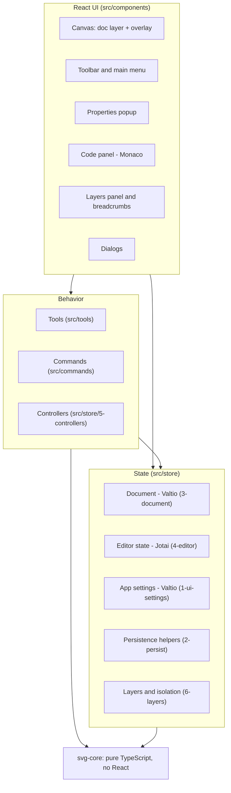
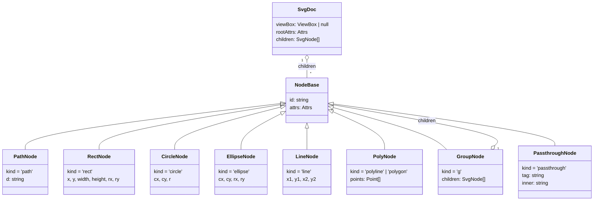
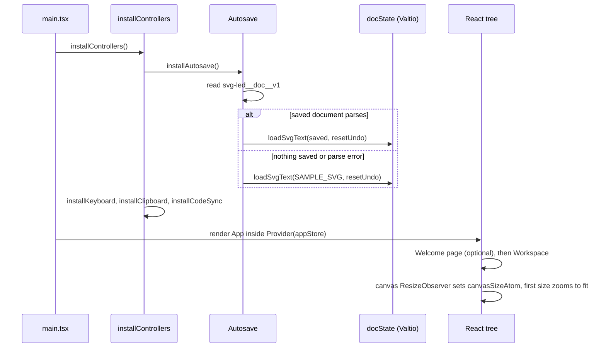
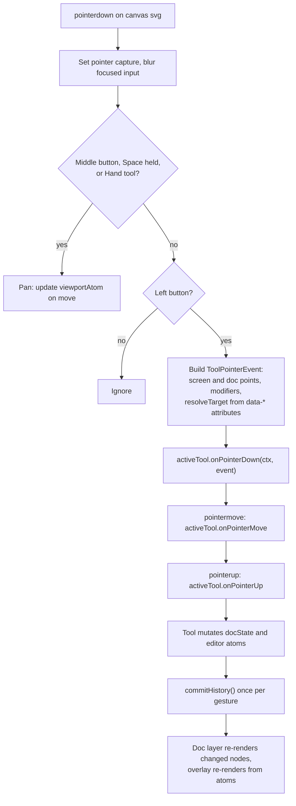
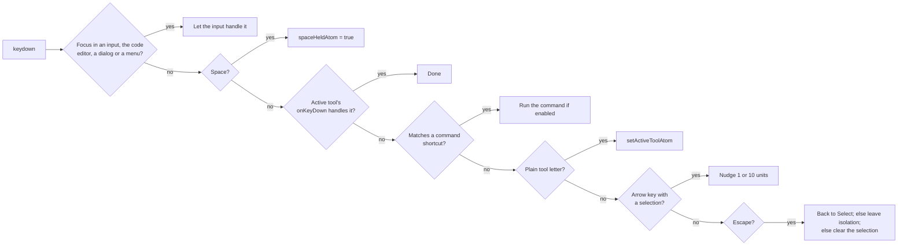
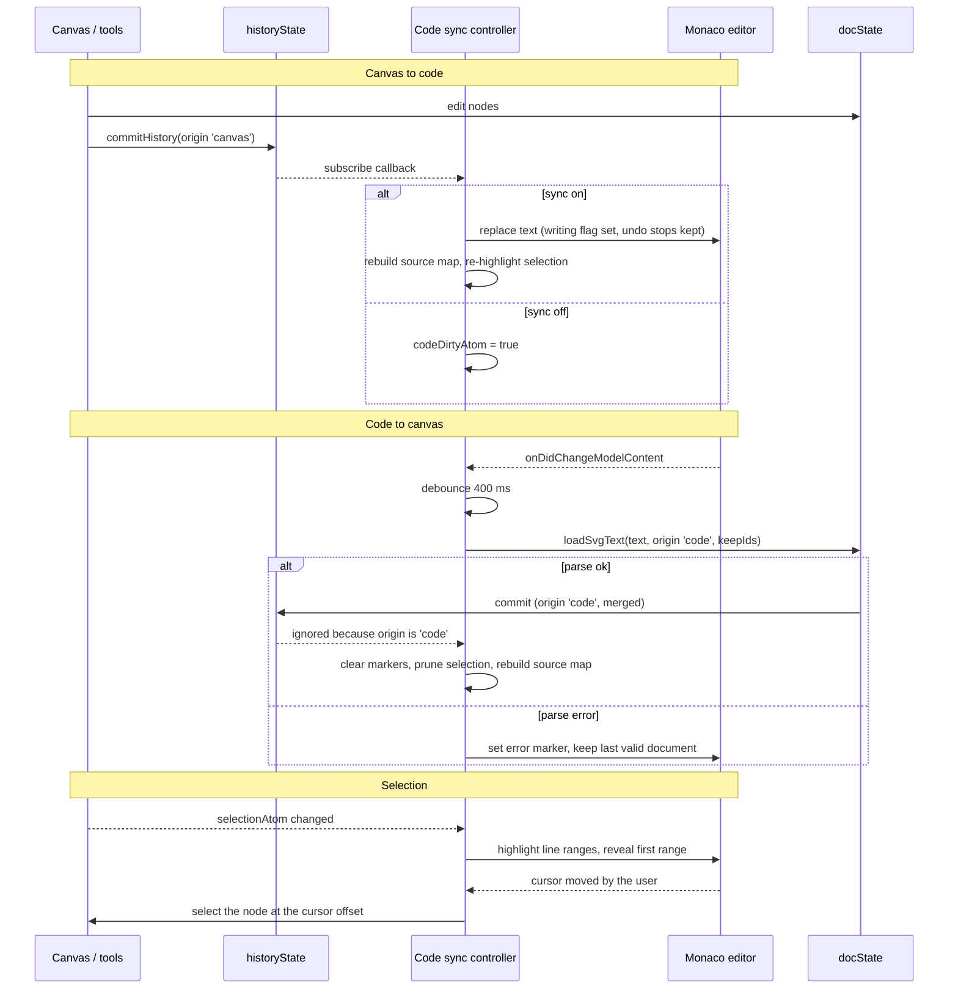
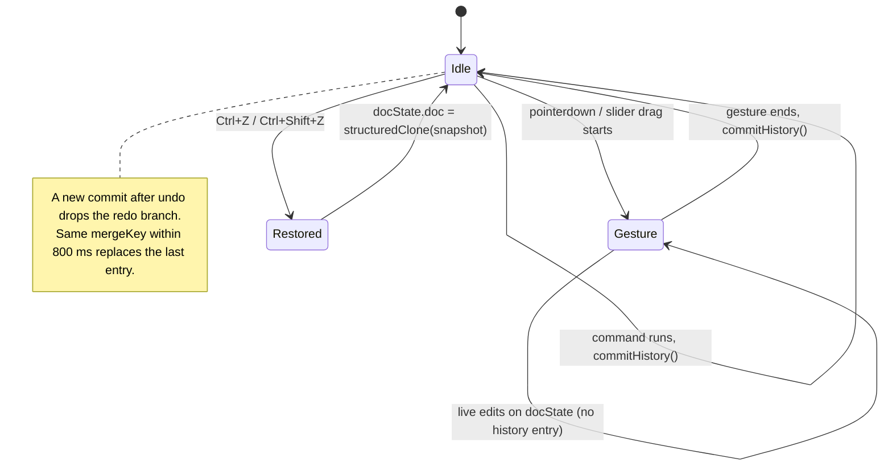
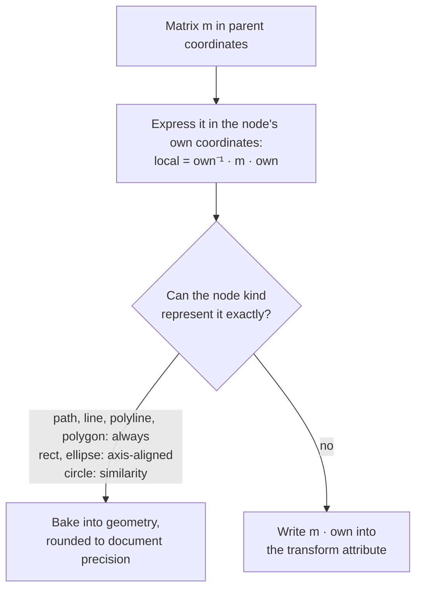

# SVG LED

A full-screen, browser-based SVG editor with Illustrator-style anchor and handle editing, viewBox tools, a Layers panel with isolation mode, and a live two-way synchronized source code panel.

## Table of contents

- [About](#about)
- [Features](#features)
- [Quick start](#quick-start)
- [Using the editor](#using-the-editor)
  - [Tools](#tools)
  - [Layers panel and isolation mode](#layers-panel-and-isolation-mode)
  - [Modifier keys](#modifier-keys)
  - [Keyboard shortcuts](#keyboard-shortcuts)
- [Architecture](#architecture)
  - [Dependency layers](#dependency-layers)
  - [Project structure](#project-structure)
  - [State ownership](#state-ownership)
  - [Component rules](#component-rules)
- [Data structures](#data-structures)
  - [Document model](#document-model)
  - [Anchor model](#anchor-model)
  - [Editor state](#editor-state)
  - [Tools and commands](#tools-and-commands)
  - [History](#history)
  - [Source map](#source-map)
- [Main processes](#main-processes)
  - [Application startup](#application-startup)
  - [Pointer input and tool dispatch](#pointer-input-and-tool-dispatch)
  - [Keyboard handling](#keyboard-handling)
  - [Code panel synchronization](#code-panel-synchronization)
  - [Undo and redo](#undo-and-redo)
  - [Transforming and fitting to the viewBox](#transforming-and-fitting-to-the-viewbox)
- [Persistence](#persistence)
- [Extending the editor](#extending-the-editor)
- [Building the project](#building-the-project)
  - [Prerequisites](#prerequisites)
  - [Scripts](#scripts)
  - [Testing](#testing)
  - [Deployment](#deployment)
- [Tech stack](#tech-stack)
- [Known limitations and roadmap](#known-limitations-and-roadmap)
- [Credits](#credits)
- [License](#license)

## About

SVG LED is a hand-tuned editor for small vector artwork such as icons, logos and indicator glyphs. It works directly on SVG markup instead of an internal drawing format: whatever you open is the document, and whatever you save is plain, readable SVG.

The editor combines three ideas:

- **An Excalidraw-like workspace.** The canvas fills the window, and the toolbar, menu, properties popup, zoom controls and Layers button float on top of it.
- **Illustrator-style point editing.** Paths are edited as anchors with direction handles (corner, smooth and cusp points), with the same modifier conventions as Illustrator's Direct Selection and Pen tools.
- **Source code as a first-class view.** A Monaco editor panel shows the SVG source. Edits on the canvas are written into the code, edits in the code are parsed back onto the canvas, and the selection is mirrored between the two.

Files round-trip cleanly. Attributes the editor does not understand are preserved, and elements it cannot edit (text, `defs`, gradients, `use`, images and so on) are kept verbatim and can still be selected and moved.

## Features

- Select, move, duplicate, group, reorder and delete elements; marquee selection, and lasso selection (Alt on empty canvas).
- Layers panel (Ctrl+Shift+L): a tree of the drawing with thumbnails, multi-selection, hide and lock, and isolation mode for groups with a breadcrumb bar.
- Points mode: move anchors and handles, add anchors on a segment without changing its shape, delete anchors, convert between corner and smooth.
- Parametric handles for native shapes (`rect`, `circle`, `ellipse`, `line`, `polyline`, `polygon`), plus **Convert to path** for full anchor editing.
- Rectangle, Ellipse, Line and Pen drawing tools, with a tool lock that keeps the tool active after drawing.
- ViewBox frame with a dimmed outside, viewBox settings, **Fit selection to viewBox** with padding, and **Fit viewBox to selection or content**.
- Properties popup: stroke, fill, stroke width, dash, line cap and join, rect corner radius, opacity, bounding box. Multi-selection shows mixed values.
- Monaco code panel with two-way sync, error markers, and selection-to-line highlighting.
- Undo and redo (up to 200 steps, with merging of continuous edits such as slider drags).
- Open and save with the File System Access API when available, export SVG and PNG (1x, 2x, 4x), copy and paste SVG markup, drag and drop files or markup onto the canvas.
- Scraps (Ctrl+E): save the selection or the whole drawing as a named snippet and load it back later.
- Command palette, find on canvas, keyboard shortcuts help, grid and snap to grid, light and dark themes, custom canvas background.
- Autosave of the current document and persistence of all preferences and tool options in `localStorage`.

## Quick start

```bash
pnpm install
pnpm dev
```

Then open <http://localhost:3000>. On the first run the editor loads a sample drawing; after that it restores the last autosaved document.

## Using the editor

### Tools

| Tool | Key | What it does |
| --- | --- | --- |
| Hand | `H` | Pans the canvas. Space or the middle mouse button pans with any tool. |
| Select | `V` or `1` | Selects, moves and resizes elements. Double-click a group to isolate it. |
| Points | `A` or `2` | Edits anchors, handles and native shape handles (Illustrator's Direct Selection). Opened from the toolbar, its key, the "Edit points" command or the menu; a double-click never opens it. |
| Rectangle | `R` or `3` | Draws a `rect`. |
| Ellipse | `O` or `4` | Draws an `ellipse`. |
| Line | `L` or `5` | Draws a `line`. |
| Pen | `P` or `6` | Click for corner anchors, click and drag for smooth anchors. Click the first anchor to close, Enter or Esc to finish, click an open endpoint to continue a path. |

The mouse wheel zooms around the cursor; Shift+wheel pans horizontally; a trackpad pinch (Ctrl+wheel) zooms faster.

### Layers panel and isolation mode

Open the Layers panel with **Ctrl+Shift+L**, the Layers button in the bottom-right island, or **Toggle Layers panel** in the command palette. It slides out from the right edge and can be resized. The tree lists the topmost element first, and groups can be collapsed. Each row has:

- An eye button to hide the element and a padlock to lock it. Hidden and locked elements cannot be selected on the canvas or in the panel. Both states are stored in the SVG as `display="none"` and `data-locked="true"`, so they are saved and can be undone. Press on an eye or padlock and drag up or down to give every row you cross the same state; the whole sweep is one undo step.
- A thumbnail and the name (the element's `id`, otherwise a tag such as `<Path>`). Double-click the name, or press **F2** with one element selected, to rename it in place. Enter applies, Escape cancels, and an empty name removes the `id`. Spaces become underscores, and a name that is already used or is not a valid id is refused. References to the old id (`url(#...)`, `href`) are not updated.
- A selection circle at the end of the row. Clicking it selects only that row. Ctrl+click toggles one row, Shift+click selects a range, and pressing on a circle and dragging across others toggles each one once.

Drag a row to reorder layers. If the row is selected, the whole selection moves, in its stacking order. A line shows a drop above or below a row; on the middle of a group row, a box shows a drop into the group, on top of its children. Elements keep their place on the canvas when they move between groups with different transforms, and a group cannot be dropped into itself.

The bottom bar has Locate, Isolate, New group, Group, Duplicate and Delete.

**Isolation mode** limits editing to one group. With the Selection tool, double-click a group on the canvas. You can also double-click its row in the panel, or use Isolate or **Enter isolation mode** in the command palette. Everything outside the isolated group is dimmed and cannot be picked by any tool, by the marquee or by the lasso. A double-click inside an isolated group goes one level deeper.

- To leave one level, press Escape or double-click empty canvas. The breadcrumb bar under the toolbar shows the path; its back arrow goes up one level, and each level is a link. Clicking the file name exits completely.
- Isolation stays on when you switch tools. New shapes, pen paths, pasted or dropped markup, and scraps go into the isolated group, in its coordinates.
- Only groups can be isolated. A top-level element with no group around it has nothing to isolate.

### Modifier keys

All modifier bindings are defined in one table, [`src/tools/tool-2-select/8-definition-of-modifiers.tsx`](src/tools/tool-2-select/8-definition-of-modifiers.tsx). The Help dialog is generated from it.

The hint line under the toolbar shows the combinations of the active tool in one short line, with keys drawn as keycaps. Holding Shift, Alt or Ctrl changes it at once to what that key does, before any click; during a drag it shows only the keys that still apply.

| Tool | Shift | Alt | Ctrl |
| --- | --- | --- | --- |
| Select | Toggle selection; constrain move axis; keep aspect on resize | Drag a copy; resize from center; on empty canvas, drag a lasso | Click to select inside a group; drag snaps to other elements; invert the marquee mode while dragging |
| Points | Toggle anchor selection; snap handle angle to 45° | Drag a handle alone (smooth becomes cusp); click to toggle corner and smooth; drag to pull out handles; on empty canvas, drag a lasso | Click a segment to add an anchor; click an anchor to delete it; drag snaps to other elements |
| Shapes | Square, circle or 45° line | Draw from the center | |
| Pen | Snap handles to 45° | Move only the outgoing handle while dragging | |

### Keyboard shortcuts

Ctrl means Cmd on macOS.

| Group | Shortcuts |
| --- | --- |
| Tools | Select `V` or `1`, Points `A` or `2`, Hand `H`, Rectangle `R` or `3`, Ellipse `O` or `4`, Line `L` or `5`, Pen `P` or `6` |
| File | Open `Ctrl+O`, Save `Ctrl+S`, Save as `Ctrl+Shift+S`, Export PNG (1x) `Ctrl+Shift+E`, Scraps `Ctrl+E` |
| Edit | Undo `Ctrl+Z`, Redo `Ctrl+Shift+Z` or `Ctrl+Y`, Copy `Ctrl+C`, Cut `Ctrl+X`, Paste `Ctrl+V`, Delete `Delete` or `Backspace`, Duplicate `Ctrl+D`, Select all `Ctrl+A` |
| Object | Group `Ctrl+G`, Ungroup `Ctrl+Shift+G`, Convert to path `Ctrl+Shift+P`, Bring forward / to front `Ctrl+]` / `Ctrl+Shift+]`, Send backward / to back `Ctrl+[` / `Ctrl+Shift+[`, Hide selection `Ctrl+Shift+H`, Lock selection `Ctrl+Shift+K`, Rename layer `F2` |
| ViewBox | Fit selection to viewBox `Ctrl+Alt+F` |
| View | Zoom in / out `Ctrl+=` / `Ctrl+-`, 100% `Ctrl+0`, Fit all `Shift+1`, Fit selection `Shift+2`, Grid `Ctrl+'`, SVG source `Ctrl+B`, Layers panel `Ctrl+Shift+L` |
| Help | Command palette `Ctrl+/`, Find on canvas `Ctrl+F`, Shortcuts help `?`, Options `Ctrl+,` |
| Other | Arrow keys nudge the selection by 1 (Shift: 10); in Points they move the selected anchors. Space and drag, or the middle mouse button, pans. Esc goes back to Select, then leaves isolation, then clears the selection. |

Mouse and key actions that are not commands (panning, arrow nudging, Esc, pen keys, double-clicks, the Scraps list) are listed in the Help dialog under "Canvas and other keys". The complete command list is in [`src/commands/0-all-commands.ts`](src/commands/0-all-commands.ts) and in the command palette.

## Architecture

### Dependency layers

The code is split into layers with a strict dependency direction: lower layers never import from higher ones.



- **`svg-core`** knows nothing about React, the DOM tree of the app or the stores. It parses, models, measures, transforms and serializes SVG, and it is covered by unit tests.
- **State** wraps the core model in observable stores and exposes document operations (move, group, convert, fit, load, save), plus the layer and isolation rules.
- **Behavior** turns input into state changes: tools handle pointer gestures, commands handle menu items and shortcuts, and controllers run app-wide integrations outside React.
- **UI** renders state and forwards input. Components contain no business logic.

### Project structure

```
src/
  main.tsx                    entry: installs controllers, renders <App> inside the Jotai Provider
  svg-core/                   pure TS geometry and SVG engine (vitest-covered)
    1-model/                  types (SvgDoc, SvgNode, Anchor, SubPath, Matrix), node ids, tree walking
    2-parse/                  parse-svg (DOMParser), path data, transform attribute
    3-serialize/              number formatting, path and document serializers, source map
    4-geometry/               matrix, bezier (split, nearest point, bbox), bbox, hit testing
    5-anchors/                path <-> anchors conversion, anchor operations
    6-shapes/                 shape-to-path, parametric shape handles
    7-ops/                    transform path data, transform nodes (bake or prepend), fit to viewBox, compound paths
    8-style/                  presentation attributes vs. style property access
    tests/                    core.test.ts
  store/
    0-app-store.ts            the single Jotai store shared by React and controllers
    1-ui-settings.ts          app settings (Valtio): theme, Welcome page, code panel, Layers panel, preferences
    2-persist/                localStorage keys, atomWithStoredOptions / atomWithToolOptions
    3-document/               doc store, history, geometry, doc actions, file I/O
    4-editor/                 tool, selection, viewport, interaction, history, code and view atoms
    5-controllers/            autosave, keyboard, clipboard, code sync
    6-layers/                 layer attributes (hidden, locked), isolation mode, pickable elements, insertion, layer actions
    7-layers-edit/            moving layers in the tree, renaming, hide and lock without a history commit (sweeps)
  tools/
    0-shared/                 target resolution, move gesture, style helpers, hint text
    tool-1-hand/ tool-2-select/ tool-3-points/ tool-4-shapes/ tool-5-pen/
    core-align/               alignment math and actions
    core-snapping/            snap engine, snap targets and snap guides
    9-types-tool-def.ts       ToolDef, ToolPointerEvent, CanvasTarget
    9-types-tools-registry.ts ordered tool list (drives toolbar, shortcuts and palette)
  commands/                   Command type, shortcut matching, command list
  components/
    0-all/                    App and global dialogs
    1-workspace/
      0-all/                  workspace layout and floating islands
      1-canvas/               canvas root, grid, doc layer, overlay (viewBox frame, selection, points, pen, marquee, lasso), context menu
      2-props-panel/          properties popup, section registry, controls, selection actions
      3-1-islands/            zoom, undo, help island (ViewBox, SVG source, Layers and help buttons), ViewBox dimensions
      3-2-island-main-toolbar/ toolbar, tool buttons, main menu
      3-3-hint-panel/         tool hint line
      5-svg-code-panel/       slide-out source panel, Monaco host, local Monaco worker setup
      6-layers-panel/         Layers panel: tree, rows, thumbnails, bottom bar; reorder, rename and eye/lock sweep in subfolders
      7-isolation-breadcrumbs/ breadcrumb bar for isolation mode
    4-dialogs/                confirmation, options, fit viewBox, viewBox settings, shortcuts help,
                              command palette, find on canvas, scraps
    5-welcome/                optional Welcome page with view transitions
  ui/                         shadcn components, local UI pieces, icons
  utils/                      general helpers
```

Numeric prefixes keep files in reading order: lower numbers are more fundamental. Files named `9-atoms-<component>.ts` hold atoms used by a single component, and `9-types-<dialog>.ts` hold a dialog's open-state atoms and types.

### State ownership

Two state libraries are used, each for what it does best.

| State | Library | Where | Why |
| --- | --- | --- | --- |
| SVG document | Valtio | `store/3-document/1-doc-store.ts` | Every node is its own nested proxy, so dragging one anchor re-renders only that element. |
| App settings | Valtio | `store/1-ui-settings.ts` | A plain object that is saved to `localStorage` on every change. |
| History | Valtio + module array | `store/3-document/2-doc-history.ts` | Snapshots live in a plain array; only `index`, `length`, `version` and `origin` are observable. |
| Tool, selection, viewport, hover, drafts | Jotai | `store/4-editor/` | Small, derived and transient values that many components read selectively. |
| Isolation mode | Jotai | `store/6-layers/` | The group being edited is editor state; the layer attributes it reads live in the document. |
| Component-local UI | Jotai | `9-atoms-*.ts` next to the component | Keeps components free of hooks logic. |

A single Jotai store (`appStore`) is created with `createStore()` and passed to the `Provider`, so controllers outside React read and write the same atoms the UI uses.

### Component rules

- Components do not use `useEffect` or `useCallback`. They read state with `useAtomValue` or `useSnapshot` and get handlers from `useSetAtom(someActionAtom)`, whose setter is already stable.
- Event handlers and multi-step updates are write-only **action atoms**: `atom(null, (get, set, arg) => ...)`.
- Subscriptions (window listeners, `ResizeObserver`, Valtio `subscribe`) use `atom.onMount` or module-level ref callbacks that return their own cleanup.
- Per-instance state uses `atomFamily` from `jotai-family`, keyed by node id.
- An atom used by one component lives next to it in `9-atoms-<component>.ts`; when a second consumer appears, it moves to `src/store/`.
- Tailwind classes follow the order checked by `pnpm check:tw` (see [`.cursor/rules/tailwind-class-order.mdc`](.cursor/rules/tailwind-class-order.mdc)).

## Data structures

### Document model

Defined in [`src/svg-core/1-model/1-types.ts`](src/svg-core/1-model/1-types.ts).



- `SvgNode` is a discriminated union on `kind`. `ShapeNode` is the subset `rect | circle | ellipse | line | polyline | polygon`.
- `id` is an internal identifier. It is never written to the output; the element's own `id` attribute, if any, stays in `attrs`.
- `attrs` holds every attribute the editor does not model as a field (`fill`, `stroke`, `style`, `class`, `transform`, the original `id`, and so on), in source order.
- Hidden and locked elements are plain attributes: hidden ones have `display="none"` and locked ones have `data-locked="true"` (see [`src/store/6-layers/1-layer-attrs.ts`](src/store/6-layers/1-layer-attrs.ts)).
- `PassthroughNode` stores an unknown element as its tag, attributes and raw inner markup.
- Supporting types: `Point { x, y }`, `Rect { x, y, width, height }`, `ViewBox = Rect`, and `Matrix = [a, b, c, d, e, f]` with the same meaning as the SVG `matrix()` transform.

### Anchor model

Paths are stored as a `d` string. When points are edited, the string is converted into subpaths of anchors, and after the edit `d` is regenerated as absolute commands at the configured precision.

```ts
type AnchorKind = 'corner' | 'smooth' | 'cusp';

type Anchor = {
    x: number; y: number;      // anchor position, path-local coordinates
    in?: Point;                // incoming direction handle (absolute position)
    out?: Point;               // outgoing direction handle (absolute position)
    kind: AnchorKind;
};

type SubPath = { anchors: Anchor[]; closed: boolean; };
```

| Illustrator | `kind` | Handles |
| --- | --- | --- |
| Corner point | `corner` | None; straight segments meet here |
| Smooth point | `smooth` | Both handles on one line; moving one rotates the other |
| Corner point with independent handles | `cusp` | Handles move independently |

Mapping rules between anchors and SVG path data:

- A segment is written as `L` when both facing handles are absent, otherwise as `C`; a missing handle equals its anchor point.
- `Q`, `T`, `S` and `A` are converted to cubics when a path is opened for editing. A closing point that repeats the start point is merged into it.
- The kind is inferred on import: `smooth` when the handles are collinear, `cusp` when they are not, `corner` when there are none.
- Adding an anchor on a segment uses a de Casteljau split, so the curve keeps its shape.

In points mode, selected anchors are identified by keys of the form `<nodeId>|<subpath>:<anchor>` for path anchors and `<nodeId>|h:<handle>` for native shape handles.

### Editor state

The main Jotai atoms in [`src/store/4-editor/`](src/store/4-editor):

| Atom | Value | Purpose |
| --- | --- | --- |
| `toolbarStateAtom` | `{ tool, locked }` | Active tool and tool lock, persisted |
| `activeToolIdAtom` | `ToolId` | Validated read-only view of the active tool |
| `setActiveToolAtom` | action | Switches tools, letting the old tool finish its work first (for example, the pen draft) |
| `selectionAtom` | `string[]` | Selected node ids |
| `selectedAnchorsAtom` | `string[]` | Selected anchor and shape-handle keys in points mode |
| `hoverNodeIdAtom` | `string \| null` | Element under the pointer |
| `viewportAtom` | `{ x, y, zoom }` | Pan and zoom; `screen = doc * zoom + (x, y)` |
| `canvasSizeAtom` | `{ width, height }` | Canvas size from a `ResizeObserver` |
| `marqueeAtom` | `Rect \| null` | Rubber-band selection rectangle in screen coordinates |
| `lassoAtom` | `Point[] \| null` | Outline of the lasso selection being drawn (Alt on empty canvas) |
| `penDraftAtom` | `PenDraft \| null` | The path being drawn by the pen tool |
| `spaceHeldAtom`, `isPanningAtom` | `boolean` | Temporary panning state |
| `heldKeysAtom` | `{ shift, alt, ctrl }` | Modifier keys held now, read by the hint line; set by the keyboard controller and by canvas pointer events |
| `toolGestureActiveAtom` | `boolean` | A pointer gesture of the active tool is in progress (button down on the canvas) |
| `snapPointAtom` | `Point \| null` | Snap guide shown while dragging |
| `sourceMapAtom`, `codeTextAtom`, `codeDirtyAtom`, `codeErrorAtom`, `monacoHandleAtom` | various | Code panel and synchronization state |

The isolation atoms in [`src/store/6-layers/`](src/store/6-layers) hold the group being edited and the actions that enter and leave it (`enterIsolationAtom`, `exitIsolationLevelAtom`). Layer visibility and lock are read from the document, so they need no atom of their own.

App settings ([`src/store/1-ui-settings.ts`](src/store/1-ui-settings.ts)) hold the theme, Welcome page options, canvas background, code panel `{ open, width, sync }`, Layers panel `{ open, width }` and editor preferences `{ showViewBox, showGrid, snapToGrid, gridSize, precision }`.

### Tools and commands

A tool is a plain object registered in [`src/tools/9-types-tools-registry.ts`](src/tools/9-types-tools-registry.ts):

```ts
type ToolDef = {
    id: ToolId;
    label: string;
    shortcut: string;                  // single key
    altShortcut?: string;              // second key, e.g. "1"
    icon: ComponentType<{ className?: string; }>;
    hint: (ctx: HintContext) => string; // one short line under the toolbar; [Key] is drawn as a keycap
    cursor: string;
    optionsAtom?: WritableAtom<ToolStyleOptions, [Partial<ToolStyleOptions>], void>;
    onPointerDown?: (ctx: ToolContext, e: ToolPointerEvent) => void;
    onPointerMove?: (ctx: ToolContext, e: ToolPointerEvent) => void;
    onPointerUp?: (ctx: ToolContext, e: ToolPointerEvent) => void;
    onKeyDown?: (ctx: ToolContext, e: KeyboardEvent) => boolean;
    onDeactivate?: (ctx: ToolContext) => void;
};
```

`ToolContext` is `{ get, set }` from the Jotai store. `ToolPointerEvent` carries the pointer position in both screen and document coordinates, the button, modifier flags, click count and a resolved `CanvasTarget`:

```ts
type CanvasTarget =
    | { type: 'none' }
    | { type: 'node'; topId: string; leafId: string }        // outermost and innermost element under the pointer
    | { type: 'anchor'; nodeId: string; key: string }
    | { type: 'handle'; nodeId: string; key: string; side: 'in' | 'out' }
    | { type: 'shape-handle'; nodeId: string; key: string }
    | { type: 'resize'; corner: 'nw' | 'ne' | 'se' | 'sw' };
```

Targets are resolved from `data-*` attributes: every rendered node carries `data-nid`, and overlay elements carry `data-hit` together with `data-nid`, `data-key`, `data-side` or `data-corner`.

A command is the unit behind menu items, shortcuts and the command palette ([`src/commands/9-command-types.ts`](src/commands/9-command-types.ts)):

```ts
type Command = {
    id: string;                        // e.g. 'object.convertToPath'
    label: string;
    group: 'file' | 'edit' | 'object' | 'viewbox' | 'view' | 'tools' | 'help';
    shortcut?: string;                 // e.g. 'Ctrl+Shift+S'
    alsoKeys?: string[];               // hidden extra bindings
    keywords?: string;                 // extra palette search terms
    enabled?: (get: Getter) => boolean;
    run: (ctx: { get; set }) => void | Promise<void>;
};
```

Property sections in the popup come from a registry in [`src/components/1-workspace/2-props-panel/1-sections/9-registry.ts`](src/components/1-workspace/2-props-panel/1-sections/9-registry.ts). Each section has an `appliesTo(nodes)` predicate and a component.

### History

```ts
type ChangeOrigin = 'canvas' | 'code' | 'load' | 'history';

type Entry = { doc: SvgDoc; mergeKey?: string; time: number; };   // doc is a frozen Valtio snapshot

historyState = { index, length, version, origin };                // observable part
```

- `commitHistory({ mergeKey, origin })` is called once per finished gesture or command, not on every pointer move.
- Consecutive commits with the same `mergeKey` within 800 ms are merged into one step, which keeps slider drags and typing from flooding the stack.
- The stack is capped at 200 entries. Snapshots are cheap because Valtio shares unchanged subtrees.
- `origin` tells subscribers where a change came from; the code-sync controller ignores changes that originated in the code editor.

### Source map

```ts
type SourceRange = { start: number; end: number; startLine: number; endLine: number; };
type SourceMap = Map<string /* node id */, SourceRange>;
```

`buildSourceMap(text, doc)` scans the source text for element ranges and pairs them with document nodes by their pre-order position, which is the same order `DOMParser` produces. Descendants of passthrough nodes are skipped. `nodeAtOffset(map, offset)` returns the innermost node that contains a text offset. This is what links canvas selection and editor lines in both directions.

## Main processes

### Application startup



### Pointer input and tool dispatch

The canvas `<svg>` has a single set of pointer handlers ([`9-atoms-canvas-root.ts`](src/components/1-workspace/1-canvas/9-atoms-canvas-root.ts)). They decide between panning and the active tool, build a `ToolPointerEvent`, and pass it on.



When no gesture is active, pointer moves only update the hover target: the innermost element in points mode, the outermost one otherwise. While isolation mode is on, only the elements of the isolated group can be hovered or picked.

The canvas is rendered in two layers:

- The **document layer** renders model nodes as React SVG elements inside a `<g>` with the viewport transform. Each node subscribes to its own proxy, so only changed nodes re-render.
- The **overlay layer** draws in screen space so handles keep a constant size: the viewBox frame with a dimmed outside, selection bounding box and resize handles, anchors and handles, the pen preview, the marquee and the lasso.

### Keyboard handling

[`src/store/5-controllers/2-keyboard.ts`](src/store/5-controllers/2-keyboard.ts) listens on `window` and gives keys to handlers in a fixed order:



Copy, cut and paste are not commands. [`src/store/5-controllers/3-clipboard.ts`](src/store/5-controllers/3-clipboard.ts) handles the native `copy`, `cut` and `paste` events, so they work with other applications too.

### Code panel synchronization

[`src/store/5-controllers/4-code-sync.ts`](src/store/5-controllers/4-code-sync.ts) attaches whenever the Monaco editor mounts and detaches when it unmounts.



Loop protection relies on two mechanisms: a `writing` flag ignores editor change events caused by the controller itself, and the history `origin` field ignores document changes that came from the editor. When text is parsed back, `keepIds` reuses node ids by position so the selection survives source edits.

With sync turned off, edits on either side mark the panel as dirty. Turning sync back on applies code typed in the meantime, or reloads the canvas into the editor; if that code does not parse, sync stays off and the code is kept.

### Undo and redo



### Transforming and fitting to the viewBox

Moving, resizing and fitting all reduce to applying an affine matrix to nodes ([`src/svg-core/7-ops/2-transform-node.ts`](src/svg-core/7-ops/2-transform-node.ts)):



Arcs stay arcs under translation and uniform scale, and are converted to cubics under skew or non-uniform scale.

**Fit selection to viewBox** computes the bounding box of the selection, builds a matrix with `fitRectMatrix(src, viewBox, { padding, keepAspect, center })`, and applies it to the selected nodes. **Fit viewBox to selection or content** does the opposite: it sets the viewBox to `viewBoxAround(bbox, padding)`. Padding can be uniform or per side, and the last values used are remembered.

## Persistence

All keys are defined in [`src/store/2-persist/8-storage-key-defs.ts`](src/store/2-persist/8-storage-key-defs.ts).

| Key | Contents |
| --- | --- |
| `svg-led__app__v1` | App settings: theme, Welcome page, code panel, Layers panel, canvas background, preferences |
| `svg-led__toolbar__v1` | Active tool and tool lock |
| `svg-led__tool:<toolId>__v1` | Options of one tool (for example, default stroke, fill and stroke width for drawing tools) |
| `svg-led__new-shape__v1` | Style that new shapes are created with; shared by all creation tools |
| `svg-led__dlg:<dialogId>__v1` | Remembered dialog values (for example, fit-to-viewBox padding) |
| `svg-led__scraps__v1` | Saved scraps (Scraps dialog) |
| `svg-led__doc__v1` | Autosaved document source, written 600 ms after the last history change and on page unload |

Stored options are merged over the defaults, and unknown or mistyped keys are dropped, so new options get their defaults and removed options do not linger. Bump the `v1` suffix of a key when its shape changes incompatibly.

## Extending the editor

The architecture is built so that new features are additions rather than edits:

- **A new tool:** create `src/tools/tool-<n>-<name>/index.ts` that exports a `ToolDef`, add its id to `ToolId` in `src/store/4-editor/1-tool-atoms.ts`, and add it to `TOOLS` in `src/tools/9-types-tools-registry.ts`. The toolbar button, keyboard shortcut and palette entry are generated. Put its modifier bindings and descriptions in `src/tools/tool-2-select/8-definition-of-modifiers.tsx`.
- **A new command:** add a `Command` to the matching group in `src/commands/0-all-commands.ts`. It appears in the command palette and in the Help dialog, and its shortcut works immediately.
- **A new property section:** add a component and an entry with an `appliesTo` predicate to `PROPERTY_SECTIONS` in [`src/components/1-workspace/2-props-panel/1-sections/9-registry.ts`](src/components/1-workspace/2-props-panel/1-sections/9-registry.ts).
- **A new app-wide integration:** write an `installX(store)` function in `src/store/5-controllers/` that returns a cleanup, and call it from `installControllers()`.
- **A key that is not a command:** add a row to `CANVAS_ROWS` in [`0-shortcuts-help-dialog.tsx`](src/components/4-dialogs/8-6-shortcuts-help/0-shortcuts-help-dialog.tsx) so the Help dialog lists it.
- **New geometry:** add pure functions to `src/svg-core/` with tests in `src/svg-core/tests/`.

## Building the project

### Prerequisites

- [Node.js](https://nodejs.org/) (a current LTS release)
- [pnpm](https://pnpm.io/)

Monaco is bundled locally with its web worker loaded through Vite's `?worker` import ([`2-monaco-setup.ts`](src/components/1-workspace/5-svg-code-panel/2-monaco-setup.ts)), so the editor works offline and does not load anything from a CDN.

### Scripts

| Command | What it does |
| --- | --- |
| `pnpm install` | Installs dependencies |
| `pnpm dev` | Starts the Vite dev server with HMR on port 3000 |
| `pnpm tsc` | Runs the TypeScript compiler in watch mode for `tsconfig.app.json` |
| `pnpm build` | Type-checks (`tsc -b`), updates the build stamp in `.env` with [`upen`](https://www.npmjs.com/package/upen), then builds with Vite into `dist/` |
| `pnpm preview` | Serves the production build locally |
| `pnpm check:tw` | Checks the Tailwind class order in components (`scripts/check-tailwind-class-order.mjs`) |
| `pnpm check:tw:fix` | Fixes the Tailwind class order |
| `pnpm to-npm` | Builds and publishes `dist/` to GitHub Pages (requires `gh-pages` to be available) |

`upen` sets `VITE_MODIFIED` to the current date and increments `VITE_BUILD` in `.env`; the app reads them through `import.meta.env` to show the version and build date.

The production build uses a relative `base`, so `dist/` can be served from any sub-path. Vendor code is split into `react`, `motion` and `vendor` chunks, among others (see [`vite.config.ts`](vite.config.ts)). The `@` import alias points to `src/`.

### Testing

Unit tests use [Vitest](https://vitest.dev/). They cover `svg-core` (path data parsing, anchor conversion and operations, matrices and bounding boxes, transform baking, fit-to-viewBox, serialization and the source map) and the tool helpers (hint text, group units, lasso selection, alignment math and snapping).

```bash
pnpm exec vitest          # watch mode
pnpm exec vitest run      # single run
```

### Deployment

The output in `dist/` is a static site with no server-side requirements. Any static host works; `pnpm to-npm` targets GitHub Pages.

## Tech stack

- [React 19](https://react.dev/) and [TypeScript](https://www.typescriptlang.org/)
- [Vite](https://vite.dev/) with [`@vitejs/plugin-react`](https://github.com/vitejs/vite-plugin-react)
- [Valtio](https://valtio.dev/) for the document and settings, [Jotai](https://jotai.org/) (with `jotai-family` and `jotai-valtio`) for editor state
- [Monaco Editor](https://microsoft.github.io/monaco-editor/) through [`@monaco-editor/react`](https://github.com/suren-atoyan/monaco-react)
- [Tailwind CSS 4](https://tailwindcss.com/), [shadcn/ui](https://ui.shadcn.com/) on [Radix UI](https://www.radix-ui.com/), [Lucide](https://lucide.dev/) icons
- [Motion](https://motion.dev/) for panel and UI animation
- [cmdk](https://cmdk.paco.me/) for the command palette, [Sonner](https://sonner.emilkowal.ski/) for toasts
- [Vitest](https://vitest.dev/) for tests

## Known limitations and roadmap

Current limitations:

- Passthrough elements (`text`, `defs`, gradients, `use`, images) can be selected and moved, but their content is edited only in the code panel.
- Once a path's points are edited, its `d` is rewritten as absolute `M`, `L`, `C` and `Z` commands; the original command style is not preserved.
- Open and Save use the File System Access API in Chromium-based browsers; other browsers fall back to a file input and a download.
- Isolation mode works on groups only. A top-level element cannot be isolated.
- Renaming a layer changes its `id` but not the references to it.

Ideas the architecture already allows:

- Snapping to anchors and smart guides
- Rulers
- Boolean path operations
- A text tool and a gradient editor
- Multiple documents in tabs

## Credits

- Interaction design inspired by [Excalidraw](https://excalidraw.com/) (workspace layout) and [Adobe Illustrator](https://www.adobe.com/products/illustrator.html) (anchor model, Direct Selection and Pen tool conventions, and the Layers panel with isolation mode).
- I extend my deep respect and appreciation to Daishi Kato for creating and maintaining the [Jotai](https://github.com/pmndrs/jotai) and [Valtio](https://github.com/pmndrs/valtio) libraries.
- Thanks  to the authors and maintainers of the excellent color processing package [color.js](https://github.com/color-js/color.js)
- Thanks to the authors and maintainers of the open-source projects listed in [Tech stack](#tech-stack), and to the [Geist](https://vercel.com/font), Roboto Condensed and Yanone Kaffeesatz font families distributed through [Fontsource](https://fontsource.org/).
- Built on the author's React template with [shadcn/ui](https://github.com/shadcn-ui/ui).
- Created by **Max Zakharzhevski**.
- Development assisted by AI coding agents in [Cursor](https://cursor.com/).

## License

[MIT](LICENSE) © Max Zakharzhevski
